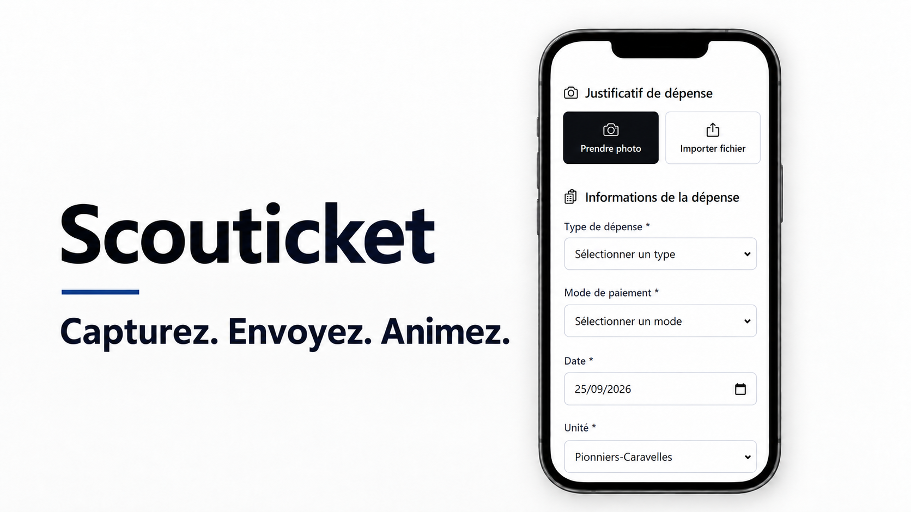

[](https://scouticket.fr)

# Scouticket

> Envoyez simplement vos justificatifs et notes de frais à la trésorerie de votre groupe scout.

Scouticket est une application gratuite et open source, pensée pour simplifier la gestion des justificatifs au sein des groupes scouts.

Libérez-vous de la gestion des justificatifs, vivez du **_scoutisme_** !

🌐 **Essayer l’application :** [scouticket.fr](https://scouticket.fr)

## Fonctionnalités

- 📸 **Capture de justificatifs** : prise de photo + import d'images/PDF, avec plusieurs fichiers possibles
- 📝 **Multi - justificatifs !** : jusqu'à 6 justificatifs par envoi
- 📌 **Unité et groupe mémorisés** : le dernier choix d’unité et le groupe principal sont enregistrés par compte
- 🏷️ **Nom de fichier structuré** : `YYYY-MM-DD - Branche - Type - Montant - 01.pdf` (ou `.jpg/.png/.webp`)
- 📲 **Installation de l'application** : Ajout possible à l'écran d'accueil (Android / iOS / Desktop), expérience proche d'une application mobile
- 👥 **Multi-groupes** : chaque groupe configure ses unités, invite ses membres et valide sa propre adresse de trésorerie

## Données personelles

- 🔐 **Données essentielles** : compte et configuration du groupe enregistrés dans la base de données.
- 📩 **Justificatifs** : transmis à la trésorerie par e-mail, avec copie à l’utilisateur.
- 🗑️ **Zéro stockage** : les justificatifs ne sont jamais conservés sur le serveur.
-

---

# Côté technique 🤓

## Technologies utilisées

- **Next.js 16** (App Router)
- **PWA** (manifest + service worker)
- **TypeScript**
- **Tailwind CSS**
- **Better Auth** (authentification)
- **Nodemailer / SMTP générique**

## Développement local

Le projet utilise pnpm 12.6.0

> Avant chaque commit, un script de vérification est exécuté pour s'assurer que le code est correctement formaté et qu'il passe les tests / build.
>
> Si le script échoue, vérifiez les erreurs et corrigez le code avant de recommencer.

### Configuration

> Copiez le fichier `.env.example` en `.env` et renseignez les variables d'environnement nécessaires.

1. Vous aurez besoin d'une base de donnée **PostgreSQL**
2. Copier l'URL de connexion de la base de données PostgreSQL dans le fichier `.env`.
3. Définissez `APP_URL` avec l’URL publique de l’application (par exemple `https://app.scouticket.fr`) afin que les liens de confirmation envoyés par e-mail soient valides.
4. Dans Google Cloud Console, ajoutez `http://localhost:3000/api/auth/callback/google` en développement et `https://votre-domaine/api/auth/callback/google` en production aux URI de redirection autorisés. `BETTER_AUTH_URL` doit correspondre exactement à l’URL publique de l’application.

5. Lancer les migrations de la base de données : `pnpm run auth:migrate && pnpm run db:migrate`

```bash
# Ajouter le dépôt
git clone https://git.latoilescoute.net/dev/scouticket.git
cd scouticket

# Installer les dépendances
pnpm install

# Lancer en développement
pnpm dev

# Build pour production
pnpm build

# Lancer les tests
pnpm test

# Lancer les tests en mode watch
pnpm test:watch

# Lancer les vérifications de PR
pnpm validate
pnpm format

# Lancer en production (si déployé localement)
pnpm start
```
